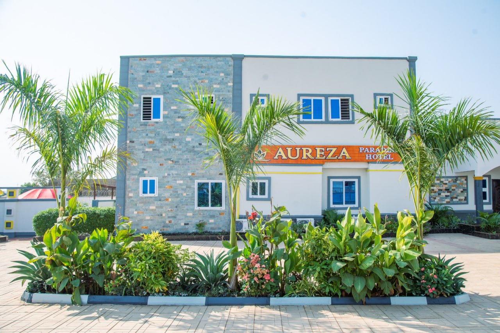

# 🏨 AUREZA PARADISE HOTEL

**Where Luxury and Serenity Meet in Tamale, Ghana.**

> [!CAUTION]
> **PROPRIETARY SOFTWARE**: All rights reserved. No part of this project or its associated files may be used, modified, or distributed without the express written permission of the copyright holders.

[Explore the Hotel](#-about-the-project) • [Services](#-luxury-services) • [Technical Guide](#-modular-architecture) • [Book Your Stay](#-get-in-touch)

---

## ✨ About the Project

**Aureza Paradise Hotel** is more than just a place to stay—it's a sanctuary in the heart of northern Ghana. This project is a **professional-grade digital landing experience** designed to capture the elegance of the hotel while providing a high-performance, mobile-first experience for guests.

The project has been architected with a **Component-First** approach, separating high-quality line-art SVGs, responsive grids, and localized metadata into a modular system that is as clean as the hotel's garden suites.

---

## 💎 Luxury Services

The hotel offers a comprehensive suite of amenities designed for both relaxation and business:

| ✨ Service               | 📋 Features                                                    |
| :----------------------- | :------------------------------------------------------------- |
| **Accommodation**  | Luxury suites with premium amenities and garden views.         |
| **Restaurant**     | Authentic local and international cuisine served daily.        |
| **Conferences**    | Professional event spaces equipped for high-level meetings.    |
| **Swimming Pools** | Serene, well-maintained pools for adult and family relaxation. |
| **Serene Gardens** | Beautifully landscaped grounds for walks and events.           |
| **Parking Space**  | Secure, spacious parking for all guests and visitors.          |

---

## 🏛️ Modular Architecture

This project is built for **Scalability and Maintainability**. It uses a specialized "Direct-Injection" component system to keep the codebase clean.

* **`/assets/css/`**: Centralized **Design Tokens** and **Modular Styles** (Buttons, Grids, Tokens).
* **`/components/`**: Atomic HTML fragments for easy, isolated content updates.
* **`index.html`**: A high-speed "Shell" that injects sections instantly on load.
* **`responsive.css`**: Micro-tuned media queries for an flawless experience on iPhones, Androids, and Tablets.

---

## 📞 Get In Touch

Ready to experience paradise? Reach out directly through the project links:

* 🏨 **Visit Us**: Malshegu, Tamale, Ghana (Digital Address: NS-522-8759)
* ☎️ **Call Phone 1**: [+233 200 011 196](tel:+233200011196)
* ☎️ **Call Phone 2**: [+233 547 795 690](tel:+233547795690)
* 📧 **Reservation**: [Send Email](mailto:aurezaparadisehotel@yahoo.com)

---

**Developed & Designed by DivAmok Corp.**

